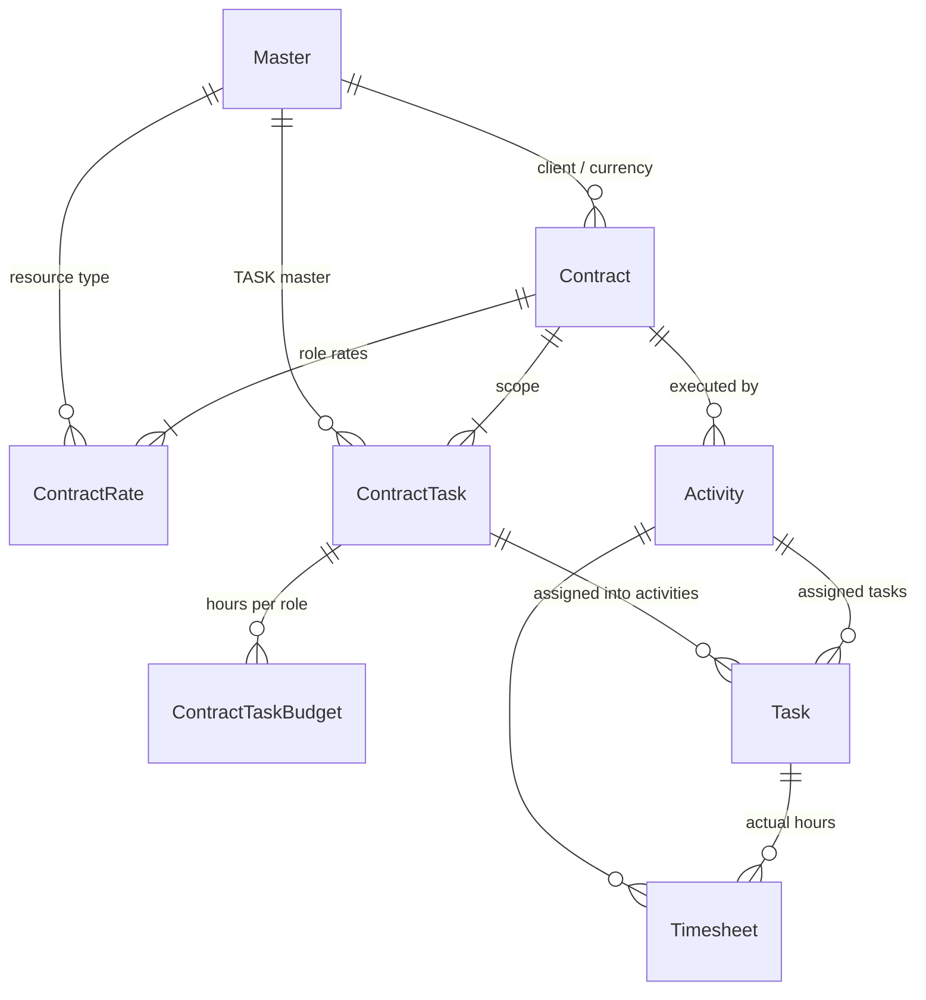

# Season 2 — Contract (SOW) driven timesheets: Phase 1 architecture review

Status: **proposal, awaiting review**. No schema or migration changes have been made.

## 1. Current domain model (as implemented)

```
Master(type, code, description)            one table, MasterType enum:
  TYPE | CLIENT | PRODUCT | VERSION | MODULE | CLOUD_ON_PREM
    │  (6 named FKs)
Activity(activityId = CLIENT.MODULE.TYPE.VERSION.SEQ, name, isActive)
    │ 1..n  (Task.activityId, no cascade)
Task(taskId, taskName, poRef?, isActive)   free text, owned by one Activity
    │
Timesheet(userId, clientId, activityId, taskId, hours Decimal(5,2), type, status…)
SandboxEntry(same shape, clientId/activityId FKs, taskId plain Int)
MISReport(data Json snapshot)
```

- `resolveTimesheetRefs` (`lib/timesheet-refs.ts`) is the single server-side check for timesheet and sandbox writes. It checks that the Activity and Task exist and are active, and that `task.activityId === activity.id`. It derives `clientId` and `type` from the Activity.
- The MIS row takes `taskId`, `beelineTask` (= `task.taskName`) and `poRef` from `Task`. The Excel column order is fixed (`lib/export.ts`).
- Permissions: the `activities.*` module covers both Activities and Tasks, and `masters.*` covers Masters.

### Discrepancies found (code vs docs)

1. **The `Role` enum order in `schema.prisma` is `EMPLOYEE, MANAGER, ADMIN, SUPER_ADMIN`.** The real rank lives in `lib/permissions.ts` (`EMPLOYEE < ADMIN < MANAGER < SUPER_ADMIN`). This is harmless because nothing sorts by enum ordinal, but the schema order is misleading. It will be left as is.
2. **The MIS "Role" column is the RBAC role (`user.role`), not a commercial role.** Billing cannot be derived from it. This matters for Part 8 (see Q4).
3. **Some Master checks miss references.** The Master `DELETE` / code-change guards (`app/api/masters/route.ts`) only count Activity FKs plus `Timesheet.clientId` / `SandboxEntry.clientId`. They must also count Contract references once the new master types exist. Otherwise a referenced Currency, Resource Type or Task master could be hard-deleted, or have its code changed.
4. **`npm run lint` is not runnable non-interactively.** No ESLint config is committed (CLAUDE.md says so), so `next lint` prompts to create one. Phase 7 will report lint as "not configured" rather than claim a pass, unless you want a config added.
5. **Deleting an unused Activity hard-deletes its Tasks** (`DELETE /api/activities`). Under Season 2 this has to keep working: an Activity's task assignments are deleted and the Contract's task budgets are untouched.

## 2. Proposed Season 2 domain model

```
Master ──┬── CLIENT ─────────────┐
         ├── CURRENCY ───────────┤
         ├── RESOURCE_TYPE ──────┤
         └── TASK ───────────────┤
                                 ▼
Contract(code UNIQUE, description, clientId, currencyId, status)
   ├── ContractRate(contractId, resourceTypeId, ratePerHour)          UNIQUE(contractId, resourceTypeId)
   └── ContractTask(contractId, taskMasterId)                          UNIQUE(contractId, taskMasterId)
          └── ContractTaskBudget(contractTaskId, resourceTypeId, hours) UNIQUE(contractTaskId, resourceTypeId)
                                 ▲
Activity(... existing fields ..., contractId?) ─┘
   └── Task  = "Activity Task" (existing table, kept) + contractTaskId?
          UNIQUE(activityId, contractTaskId)
          └── Timesheet.taskId (unchanged FK)
```

Key decision: **the existing `Task` table becomes the "Activity Task assignment".** It keeps its id, so every historical `Timesheet.taskId` and `SandboxEntry.taskId` stays valid with no data rewrite. A new nullable `contractTaskId` links it to the SOW scope line. `Task.taskId` and `taskName` stay as the per-activity labels the MIS / Beeline export already prints. They are pre-filled from the TASK master code and description when assigned. This keeps the Excel output identical.

Why not reuse `Task` as the SOW line: a SOW line is commercial (a budget per role), while an Activity Task is operational (where time is logged). The same SOW line may be delivered through more than one Activity. Keeping the two tables separate models that distinction without denormalising the budget onto every activity.

## 3. Prisma schema changes (proposed, not applied)

```prisma
enum MasterType {
  TYPE
  CLIENT
  PRODUCT
  VERSION
  MODULE
  CLOUD_ON_PREM
  CURRENCY        // new
  RESOURCE_TYPE   // new — commercial billing role, unrelated to RBAC Role
  TASK            // new — generic task catalogue
}

enum ContractStatus {
  DRAFT
  ACTIVE
  CLOSED
}

model Contract {
  id          Int            @id @default(autoincrement())
  code        String         @unique            // SOW code, upper-cased like Master.code
  description String?        @db.Text
  clientId    Int
  client      Master         @relation("ContractClient", fields: [clientId], references: [id])
  currencyId  Int
  currency    Master         @relation("ContractCurrency", fields: [currencyId], references: [id])
  poRef       String?                            // replaces Task.poRef going forward (see Q2)
  status      ContractStatus @default(DRAFT)
  activatedAt DateTime?
  closedAt    DateTime?
  createdById Int
  createdBy   User           @relation("ContractCreator", fields: [createdById], references: [id])
  createdAt   DateTime       @default(now())
  updatedAt   DateTime       @updatedAt

  rates      ContractRate[]
  tasks      ContractTask[]
  activities Activity[]

  @@index([clientId])
  @@index([status])
}

model ContractRate {
  id             Int      @id @default(autoincrement())
  contractId     Int
  contract       Contract @relation(fields: [contractId], references: [id], onDelete: Cascade)
  resourceTypeId Int
  resourceType   Master   @relation("ContractRateResource", fields: [resourceTypeId], references: [id])
  ratePerHour    Decimal  @db.Decimal(12, 2)

  @@unique([contractId, resourceTypeId])
}

model ContractTask {
  id           Int      @id @default(autoincrement())
  contractId   Int
  contract     Contract @relation(fields: [contractId], references: [id], onDelete: Cascade)
  taskMasterId Int
  taskMaster   Master   @relation("ContractTaskMaster", fields: [taskMasterId], references: [id])
  sortOrder    Int      @default(0)

  budgets       ContractTaskBudget[]
  activityTasks Task[]

  @@unique([contractId, taskMasterId])
}

model ContractTaskBudget {
  contractTaskId Int
  contractTask   ContractTask @relation(fields: [contractTaskId], references: [id], onDelete: Cascade)
  resourceTypeId Int
  resourceType   Master       @relation("ContractBudgetResource", fields: [resourceTypeId], references: [id])
  hours          Decimal      @db.Decimal(10, 2)

  @@id([contractTaskId, resourceTypeId])
}

model Activity {
  // …all existing fields unchanged…
  contractId Int?
  contract   Contract? @relation(fields: [contractId], references: [id])
  @@index([contractId])
}

model Task {
  // …all existing fields unchanged (taskId, taskName, poRef kept for history)…
  contractTaskId Int?
  contractTask   ContractTask? @relation(fields: [contractTaskId], references: [id])
  @@unique([activityId, contractTaskId])   // a SOW task at most once per Activity
}
```

Notes:

- **Cascades.** `onDelete: Cascade` applies only inside a Contract aggregate (rates, tasks, budgets). A Contract can be hard-deleted only while it is DRAFT and no Activity references it. Master, Activity and Task FKs stay `Restrict` (the Prisma default).
- **Budget rows only for roles in the rate table.** This is enforced in the service layer inside one transaction, because MySQL cannot express a composite FK to `ContractRate` here without extra keys.
- **Totals are not stored.** Total hours and amount are computed on read from rates × budgets by one shared function. Contract volumes are small, and this removes any chance of stale denormalised totals.
- **Activity.contractId is nullable in the database but required by the API for new Activities.** Legacy V1 activities stay valid until a Contract is attached (see the migration strategy).
- **Money is handled in integers, with no floats and no new dependency.** A new pure module, `lib/contract-calc.ts`, converts `rate` (2 dp) and `hours` (2 dp) into scaled integers (`×100`). Amount = `rate100 × hours100` is an exact integer in 1/10000 units, rounded half-up to 2 dp only at output. The client preview and the server use this same module. The server ignores any totals the client submits. Unit-tested.

## 4. Relationship diagram



## 5. API changes

| Route | Change |
|---|---|
| `GET/POST/PUT/DELETE /api/masters` | New enum values need no code change. Reference guards gain Contract / ContractRate / ContractTask / ContractTaskBudget counts. |
| `GET /api/contracts` | New. List with computed totals; `?status=ACTIVE&clientId=` lite mode for the Activity form (code, description, tasks, **no rates**). |
| `GET /api/contracts/[id]` | New. Header, rates, tasks, budgets and computed totals. |
| `POST /api/contracts` | New. Creates the header, rates and budgets atomically in one transaction; status DRAFT, or ACTIVE with "Save & Activate". |
| `PUT /api/contracts/[id]` | New. Replaces rates and budgets atomically, with lifecycle guards (§7). |
| `POST /api/contracts/[id]/status` | New. `activate` / `close` / `reopen` transitions. |
| `DELETE /api/contracts/[id]` | New. Hard delete only while DRAFT and unreferenced; otherwise 400 with "close it instead". |
| `POST/PUT /api/activities` | Accepts `contractId` plus `contractTaskIds[]`. The Contract must be ACTIVE and belong to the same Client, and every id must be a `ContractTask` of that Contract. Task rows are created or reactivated in the same transaction. |
| `POST/PUT /api/tasks` | New tasks must reference a `contractTaskId` of the Activity's Contract. Legacy free-text tasks can only be created on Activities that have no Contract. |
| `GET /api/activities?active=1` | Adds `contract { code, poRef }` and per-task `contractTask.taskMaster` code. **Never rates.** |
| `resolveTimesheetRefs` | Adds: if the Activity has a Contract, the task's `contractTask.contractId === activity.contractId`, the Contract is ACTIVE (or `allowInactive` covers an unchanged edit), and the TASK master is active. Timesheet and sandbox writes get this automatically. |
| `middleware.ts` | Adds `/api/contracts` and `/admin/contracts` to the staff-only list and `matcher`. |

## 6. UI changes

- **Masters panel:** three new options (Currency, Resource Type, Tasks). Seeded with GBP/INR/USD and TC/LC/BC/SA.
- **New `/admin/contracts`** (list page), **`/admin/contracts/new`** and **`/admin/contracts/[id]`** (a shared editor):
  - Header: Code, Description, Client, Currency, PO Ref.
  - Role Rates table with "Add New Entry": role dropdown from `RESOURCE_TYPE` masters, excluding roles already used; decimal rate input.
  - Task Budget grid: role columns generated from the rates state, "Add Task" rows with a `TASK` dropdown that excludes tasks already used, live row and column totals, and a Total Amount row.
  - Removing a role that has non-zero hours asks for confirmation first.
  - Actions: Save Draft / Save & Activate / Close.
- **Activities dialog:** a new required "Contract / SOW" select, filtered by the chosen Client and ACTIVE only, followed by a checklist of that SOW's tasks. The Activity card shows a SOW badge. The task table shows the SOW task code, and the PO Ref column now reads from the Contract.
- **Employee timesheet:** no new selects. The PO Ref / SOW is shown read-only next to Type.
- **Nav:** a "Contracts" item gated on `contracts.view`.

## 7. Contract lifecycle (proposed transitions)

This follows the existing conventions: `TimesheetStatus` is an enum plus timestamps, and Masters and Activities use `isActive` soft delete.

```
DRAFT ──activate──▶ ACTIVE ──close──▶ CLOSED
  │                    ▲                 │
  └─delete (if unused) └────reopen───────┘   (reopen needs contracts.delete)
```

| State | Editable | Selectable on new Activity | Time can be logged |
|---|---|---|---|
| DRAFT | Everything | No | No |
| ACTIVE | Header description, PO Ref; rates; budgets; add roles/tasks. A role or task **already used by an Activity Task / timesheet cannot be removed**. Code, client and currency are locked. | Yes | Yes |
| CLOSED | Nothing (read-only) | No | No new entries; existing DRAFT/REJECTED edits keep ids via `allowInactive` |

Every transition and save writes an audit entry: `contract.create`, `contract.update`, `contract.activate`, `contract.close`, `contract.reopen` or `contract.delete`, with a summary of what changed in `meta`.

## 8. RBAC changes

- A new `contracts` module with actions `view`, `edit` and `delete`. `delete` also covers close and reopen, mirroring how `masters.delete` soft-deletes. It gets its own row in the Access Panel with no special UI code, because the panel iterates `MODULES`.
- **Defaults: MANAGER and SUPER_ADMIN get all contract permissions. ADMIN gets `contracts.view` only (see Q3).**
- **Existing overrides are preserved.** `resolvePermissions` ignores unknown keys, so no data migration is needed.
- **The Activity form needs a lite list of ACTIVE contracts.** That list is served to `activities.edit` holders without `contracts.view` and **excludes rates and amounts**. Commercial figures are never visible to someone who has only activity rights, or to employees.
- `permissions.test.ts` gains tests for the new defaults and for no escalation.

## 9. Migration strategy and potential breaking changes

One additive migration, hand-written because of the non-interactive shell (`migrate diff` → folder → `migrate deploy`):

1. `ALTER TABLE Master MODIFY type ENUM(... + 'CURRENCY','RESOURCE_TYPE','TASK')`. This is additive and safe on MySQL.
2. `CREATE TABLE` for Contract, ContractRate, ContractTask and ContractTaskBudget.
3. `ALTER TABLE Activity ADD contractId NULL` and `ALTER TABLE Task ADD contractTaskId NULL`, with their FKs and the unique index.
4. The seed upserts currency and resource-type masters, and one demo Contract linked to a seeded activity.

**No existing row is modified or deleted. Finalized `MISReport.data` JSON is untouched.**

Legacy data: V1 Activities keep `contractId = NULL` and their free-text tasks keep working (the validator skips contract checks when the Activity has none). The Activities page flags them "No SOW" so staff can attach one. Attaching a Contract to a legacy Activity lets staff map each existing task to a SOW task (Q1b).

Breaking or behavioural changes:

- Creating an Activity now requires a Contract, so an ACTIVE Contract must exist first.
- New Tasks can no longer be free text on contract-backed Activities.
- The MIS `poRef` column resolves as `contract.poRef ?? task.poRef`. For existing rows the output is identical, because contracts are new.

## 10. Phased checklist

- [ ] P2 Masters: add the enum values, the migration, panel options, guards counting contract references, seed, tests, docs.
- [ ] P3 Contracts:
  - [ ] schema
  - [ ] `lib/contract-calc.ts` (with tests)
  - [ ] `lib/contract-service.ts` (validate and replace in a transaction, lifecycle)
  - [ ] Zod schemas
  - [ ] API routes
  - [ ] pages and editor
  - [ ] permissions module
  - [ ] middleware
  - [ ] nav
  - [ ] audit
- [ ] P4 Activities:
  - [ ] `contractId` plus task-subset assignment
  - [ ] legacy "No SOW" flag and mapping
  - [ ] guards on removing an assigned task (deactivate when it has timesheets)
- [ ] P5 Timesheets:
  - [ ] extend `resolveTimesheetRefs`
  - [ ] payload adds contract code and PO Ref (no rates)
  - [ ] verify the existing flows
- [ ] P6 MIS / Sandbox:
  - [ ] PO Ref fallback
  - [ ] add `contractId` / `resourceType` to `MISRow` (not exported), ready for budget-vs-actual
  - [ ] docs
- [ ] P7 Verify:
  - [ ] `prisma validate` / `generate`
  - [ ] `tsc`
  - [ ] `npm test`
  - [ ] lint (see discrepancy 4)
  - [ ] build (only once the user's dev server is stopped)

## Decisions (2026-09-29)

- **Q1 — one SOW task in several Activities: allowed.** The budget is shared. Actual hours from every Activity Task linked to the same `ContractTask` consume that one budget line. The `@@unique([activityId, contractTaskId])` constraint still stops the same SOW task appearing twice in one Activity.
- **Q3 — ADMIN defaults: no `contracts.*` permissions.** MANAGER and SUPER_ADMIN get everything. Admins can be granted access per user via the Access Panel.
- **Q4 — billing role: set per Activity member.** A new join model is added:

  ```prisma
  model ActivityMember {
    activityId     Int
    activity       Activity @relation(fields: [activityId], references: [id], onDelete: Cascade)
    userId         Int
    user           User     @relation(fields: [userId], references: [id])
    resourceTypeId Int
    resourceType   Master   @relation("ActivityMemberResource", fields: [resourceTypeId], references: [id])
    @@id([activityId, userId])
    @@index([userId])
  }
  ```

  The member's `resourceTypeId` must be one of the roles in the Activity's Contract rate table. Each timesheet gets a nullable `resourceTypeId` column, which the server snapshots from the membership on create and update. Later role changes therefore do not rewrite past billing.
- **Q5 — currency: one per Contract.** It is picked in the header, and the rate rows show it read-only.

## Decisions (continued, 2026-09-29)

- **Q2 — PO reference: the SOW code is the PO reference.** `Contract` has no separate `poRef` column. The MIS "PO Ref." column shows the Activity's contract code, falling back to the legacy `Task.poRef`.
- **Q1b — legacy Activities get their own contract.** Every V1 Activity is given a contract. `lib/contract-backfill.ts` (`npm run db:backfill-contracts`, which the seed also runs) does this in four steps:
  1. It reuses the contract whose code equals the Activity's task PO reference. If there is none, it creates one: `ACTIVE`, one zero rate at TC, and code `LEGACY-<activityId>` when there is no usable PO.
  2. It adds a SOW line for each legacy task code, keeping the task ids.
  3. It makes everyone who has already logged time on the Activity a member.
  4. The seed attaches its own demo Activities to the seeded contracts, with the listed members.
- **Q6 — members only.** Contract-backed Activities are listed to, and accept time from, their members only. Pre-contract Activities stay open to all, but after the backfill none remain.

## Implementation status

| Phase | Result | Commit |
|---|---|---|
| 2 Masters | Done | e412d3f |
| 3 Contracts | Done | 0e4c43b |
| 4 Activities | Done | 7d1a58c |
| 5 Timesheets | Done | 94b8e4c |
| 6 MIS / Sandbox / docs | Done | this commit |

Final schema differences from §3:

- There is no `Contract.poRef` (see Q2).
- There is an extra `ActivityMember` table.
- There is an extra `Timesheet.resourceTypeId` column, a billing-role snapshot taken when the owner saves.
- The optional FKs `Activity.contractId`, `Task.contractTaskId` and `Timesheet.resourceTypeId` use `ON DELETE RESTRICT`.
